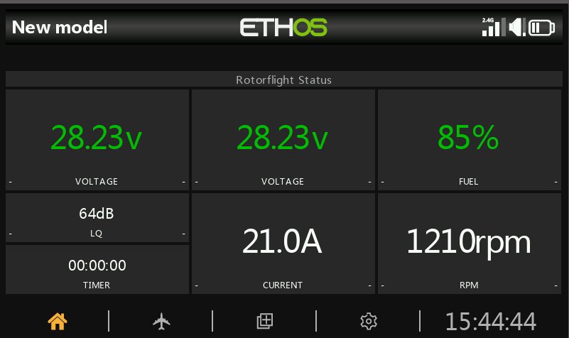
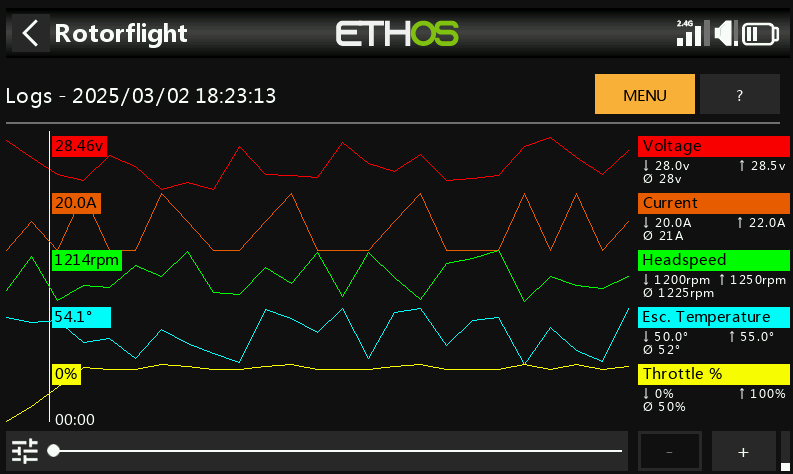
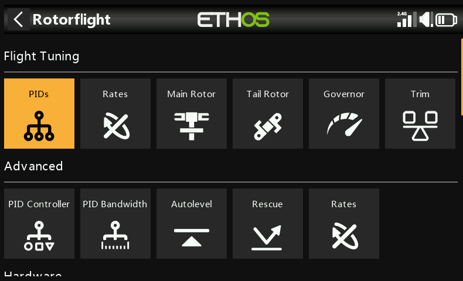
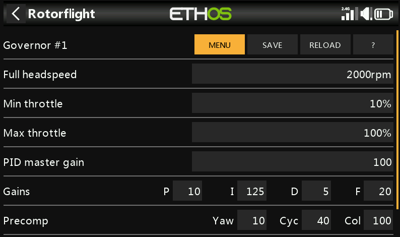

# RFSuite Lua Scripts for Ethos

**Rotorflight** is a powerful flight control software suite built specifically for **single-rotor RC helicopters**. It is not designed for multirotors or airplanes. The software includes:

-   **Rotorflight Flight Controller Firmware**
    
-   **Rotorflight Configurator** – used for flashing and configuring the flight controller
    
-   **Rotorflight Blackbox Explorer** – for analyzing flight logs
    
-   **Rotorflight Lua Scripts** – used to configure the flight controller directly from your transmitter
    

These scripts support the following transmitter operating systems:

-   **EdgeTX / OpenTX**
    
-   **Ethos** (this repository)
    

Rotorflight is based on **Betaflight 4.3**, but includes a wide range of advanced features optimized for helicopter flight. This version of Rotorflight is also referred to as **Rotorflight 2 (RF2)**.

----------

## What is RFSuite?

**RFSuite** is a touch-based, Lua-scripted GUI suite for the Ethos platform. It enables easy setup, tuning, and diagnostics of Rotorflight-based helicopters using supported FrSky transmitters. It offers:

-   Full touchscreen interface
    
-   FrSky and ELRS receiver compatibility
    
-   Multiple embedded tools and widgets

-   Flight-phase dashboards with statistics and quick access to battery profiles

-   SmartFuel monitoring and battery profile management

-   Configurable voice announcements and alerts for flight status, battery, ESC temperature and telemetry loss

-   Multilingual interface and localized sound packs
    

You can preview the experience using the interactive simulator:

👉 [**Launch Web Simulator**](https://ethos.studio1247.com/nightly16/X20PRO_FCC?backup=https://github.com/rotorflight/rotorflight-lua-ethos-suite/raw/refs/heads/master/demo/DEMO.zip&reset=all&language=en)

This opens the RFSuite in your browser, showcasing its functionality within the Ethos UI.

### Key UI Screens

**Status Widget**  
Dashboard themes are available for different flight states. See the [Dashboard Themes Overview](docs/dashboard-themes/) to compare the available theme previews.



**Flight Logs**  


**FBL Configuration (Home)**  


**Governor Configuration**  


### ActiveLook Smart Glasses

RFSuite can display telemetry and alerts on compatible ActiveLook smart glasses, with configurable layouts for preflight, inflight and postflight. See the [ActiveLook Layout Overview](docs/Activelook%20Layout%20Overview.md) for previews of all five layouts and the alarm and status overlays.

----------

## Documentation

- **[Configuration Pages](docs/pages/README.md):** Reference for all 86 configuration and tuning pages, organized by menu domain (*Flight Tuning*, *Setup*, *Tools*, *Logs*, *Settings*). Generated from the menu hierarchy and the page sources, and filled in as changes reach them — see the index for the current page list.
- **[Documentation Overview](docs/README.md):** Directory map, conventions, dashboard theme overviews, and memory lifecycle guides.
- **[Page Template](docs/_template.md):** Canonical template and frontmatter standard for all configuration pages.
- **[Scaffold Generator](bin/docs/generate_menu_docs.py):** CLI tool to scaffold, inspect, and verify that every reachable page has a documentation file (`bin/docs/generate_menu_docs.cmd --check`). It checks that a file exists, not that its contents are right.

----------

## Rotorflight Features

Rotorflight includes a rich feature set, including:

### Protocol Support

-   Receiver: CRSF, S.BUS, F.Port, DSM, IBUS, XBUS, EXBUS, GHOST, CPPM
    
-   Telemetry: CRSF, S.Port, HoTT, and more
    
-   ESC telemetry: BLHeli32, Hobbywing V4/V5, Scorpion, Kontronik, OMP Hobby, ZTW, APD, YGE (OpenYGE), FlyRotor, Graupner, XDFLY and FrSky F.BUS; SRXL2
    

### Helicopter-Specific Features

-   Advanced PID control tuned for helicopters
    
-   Rotor speed governor
    
-   Stabilization modes (6D)
    
-   Tail Torque Assist (TTA or TALY)
    
-   Motorized tail support
    

### Remote Tuning & Configuration

-   Via transmitter knobs/switches
    
-   Lua script interface on EdgeTX/OpenTX/Ethos
    

### ESC Forward Programming

RFSuite lets you read and adjust compatible ESC settings directly from your Ethos transmitter, including motor timing, startup behavior, governor settings and BEC voltage where supported. Available settings depend on the ESC model and firmware.

-   Supported ESC manufacturers and firmware: **Hobbywing (V5), FlyRotor, OMP Hobby, Scorpion, XDFLY, YGE and ZTW, AM32, BLHeli_S and Bluejay**

### Additional Capabilities

-   AUX outputs for custom motor/servo functions
    
-   Fully customizable mixer
    
-   Sensor support: voltage, current, BEC, etc.
    
-   Advanced filtering: Dynamic RPM notch, FFT-based notch, and LPF
    
-   High-speed Blackbox logging
    

### Plus Betaflight-Inherited Features:

-   Multiple configuration and rate profiles
    
-   DSHOT, PWM, Multishot ESC protocols
    
-   RGB LEDs and buzzers
    
-   GPS integration
    

----------

## Lua Script Requirements

To use RFSuite, you'll need:

-   **Ethos 1.6.2 or later**
    
-   A compatible FrSky transmitter:
    
    -   X10, X12, X14, X18, X20, XE or Twin X Lite
        
-   A supported receiver:
    
    -   FrSky (Smartport or F.Port over ACCESS, ACCST, TD, TW)
        
    -   ExpressLRS (ELRS) modules supported by Ethos
        

----------

## Verified Compatible Receivers

RFSuite has been successfully tested on the following receiver models (with X10, X14, X18, X20, XLite):

-   TWMX
    
-   TD MX
    
-   R9 MX ACCESS
    
-   R9 Mini ACCESS
    
-   Archer RS / Archer Plus RS / RS Mini (ACCESS / F.Port)
    
-   RX6R ACCESS
    
-   R-XSR ACCESS / ACCST F.Port
    
-   ELRS (all versions)

----------    

## Installation Instructions

### Radio Updater (GUI)

For Windows, Mac & Linux users, a prebuilt GUI updater is available to simplify updating files on the radio without using VS Code or Python.

- **Download:** https://github.com/rotorflight/rotorflight-lua-ethos-suite-updater/releases
- Standalone Windows executable (plus macOS/Linux builds)
- Intended for end users or quick updates


### Alternative: Manual Installation via FrSky Suite

You can also install a release package using **FrSky Suite** (formerly Ethos Suite):

1. Download the RFSuite release ZIP for your language from the [Releases page](https://github.com/rotorflight/rotorflight-lua-ethos-suite/releases), under **Assets**.
2. Connect your transmitter to FrSky Suite and open **ETHOS → Lua library**.
3. Under **Install Lua scripts**, open the downloaded ZIP to install it on the radio.

Use a release package rather than **Code → Download ZIP**, which contains the source files. See the [official Suite guide](https://ethos-lua-doc.frsky-rc.com/tools/frsky-suite/) for details.

----------

## Development Guide

To build and deploy RFSuite locally:

### Requirements

-   Visual Studio Code (VS Code)
    
-   Python 3
    
-   Install libraries (optional: the deploy tasks install any that are missing on first run)
    
    ```bash
    python -m pip install -r requirements.txt
    ```

    Radio HID control uses the `hidapi` package, which includes the native
    library, so no separate `hidapi.dll` or `brew install hidapi` is needed.

- Install the VS Code extension `Ethos`


### VS Code Tasks

Run these via **Terminal → Run Task**. For simulator deployment and launch together, select **Deploy & Launch [SIM]** in **Run and Debug**.

| Task | Purpose |
| --- | --- |
| **Deploy & Launch [SIM]** | Deploys to the configured simulator; the Run and Debug configuration also launches it. |
| **Deploy Radio** | Deploys scripts, translations, sound packs and sensors to the radio. |
| **Deploy Radio + Serial Debug** | Deploys to the radio and opens the serial debug console. |
| **Radio: Serial Debug** | Opens the serial debug console without deploying. |
| **Run RFSuite Sensor Tool** | Opens the sensor editor for simulator test values. |
| **ActiveLook Preview** | Opens the local browser preview for layouts, telemetry and alerts; requires Python 3.11+ and the [preview dependencies](bin/activelook_preview/README.md). |

For language selection, use **Set Deployment Language** in **Run and Debug**, or set `rfsuite.deploy.language` in `.vscode/settings.json`. The task **RFSuite: Set Deployment Language** currently lacks its input definition in `tasks.json`.

----------

## Contributing

Rotorflight is a community-driven open-source project. You can contribute by:

-   Helping users on [Rotorflight Discord](https://discord.com/) or forums
    
-   Reporting issues or requesting features via [GitHub](https://github.com/rotorflight)
    
-   Testing and giving feedback on new versions
    
-   Updating the [Rotorflight documentation](https://doc.rotorflight.org/stable/contributing/editing-the-docs/)
    
-   Translating the configurator to other languages
    
-   Contributing code (fixes, features, enhancements)
    

🔧 See the full [Contributing Guide](https://doc.rotorflight.org/stable/contributing/)

----------

## Project Origins

Rotorflight is **open source** and available free of charge, with no warranties.

-   Forked from [Betaflight](https://github.com/betaflight)
    
-   Which was forked from [Cleanflight](https://github.com/cleanflight)
    
-   Also draws inspiration and code from [HeliFlight3D](https://github.com/heliflight3d/)
    

🙏 A big thank you to everyone who has contributed along the way!

----------

## Contact

📧 Reach out to the Rotorflight team at:  
**[rotorflightfc@gmail.com](mailto:rotorflightfc@gmail.com)**


## Donate

If you find Rotorflight useful, please consider [supporting the development by donating](https://opencollective.com/rotorflight/donate) to the Rotorflight Project.
