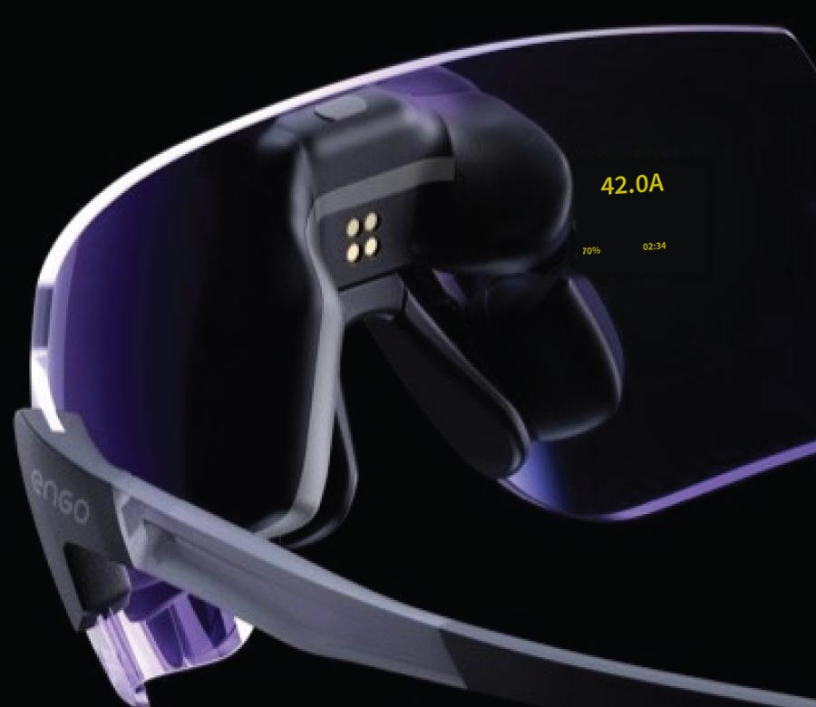
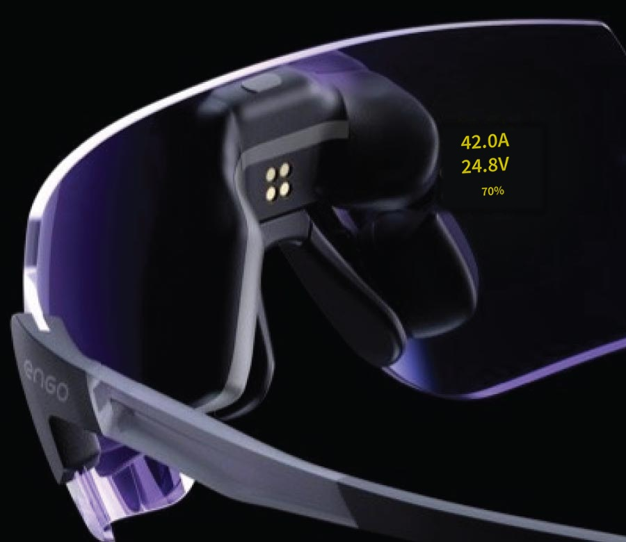
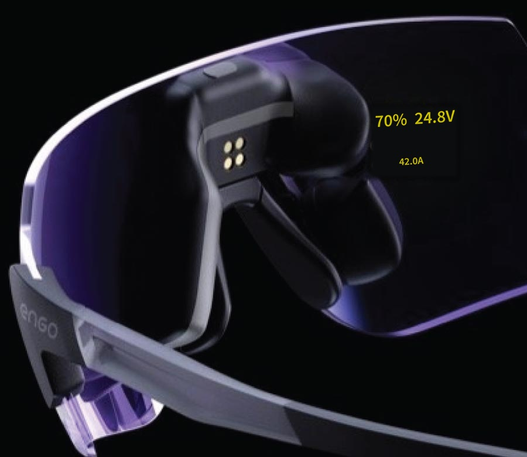
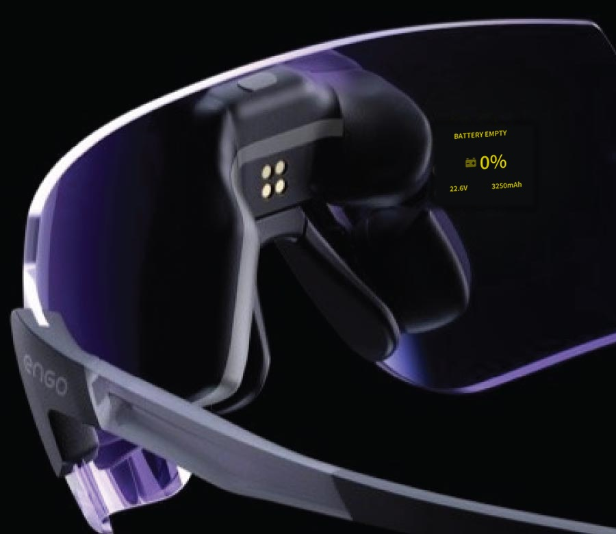

# ActiveLook Layout Overview

These static examples show all five ActiveLook layouts as a yellow display projected
onto the ENGO glasses photograph. No webserver, simulator or connected glasses are
needed to view them. Click an image to open it at full size.

Choose a layout and assign values independently for **Preflight**, **Inflight** and
**Postflight** under **System → Settings → ActiveLook** on the transmitter.
The images use the suite's actual Lua layout renderer and the bundled ActiveLook
font. The photograph and optical projection are illustrative; brightness and text
appearance on real glasses can differ. These are example assignments, not required
settings or live telemetry.

## Layout gallery

Each layout is shown once with illustrative telemetry values. Only its active
slots appear; **One Top + Two Bottom uses slots 1, 3 and 4**. The values can be
assigned freely in the settings.

### Single Centered

Active slots: **1**.

[](assets/activelook-layouts/one_centered_inflight.jpg)

### One Top + Two Bottom

Active slots: **1, 3, 4**.

[](assets/activelook-layouts/one_top_two_bottom_inflight.jpg)

### Stacked Large + Large + Small

Active slots: **1, 2, 3**.

[](assets/activelook-layouts/stacked_three_inflight.jpg)

### Two Top + One Bottom

Active slots: **1, 2, 3**.

[](assets/activelook-layouts/two_top_one_bottom_inflight.jpg)

### Two Top + Two Bottom

Active slots: **1, 2, 3, 4**.

[](assets/activelook-layouts/two_top_two_bottom_inflight.jpg)

## Alarm and status previews

These examples show the temporary overlays that replace the normal layout.
The screenshots use English display text and fixed example telemetry. Static
images capture the visible part of blinking symbols; they do not show timing,
repetitions or alarm priority. Warning symbols can be switched off in settings.

### Battery Empty — Electric

The electric model variant shows BATTERY EMPTY, Smart Fuel, voltage and consumed capacity.

[](assets/activelook-layouts/alert_battery_empty.jpg)

### Low Fuel — Nitro

The Nitro model variant shows LOW FUEL with the fuel symbol, Smart Fuel, voltage and consumed capacity.

[](assets/activelook-layouts/alert_low_fuel.jpg)

### ESC Temperature High

Shows the ESC temperature and its configured limit; this example uses Celsius.

[](assets/activelook-layouts/alert_esc_temperature.jpg)

### RF Link Low

Shows the low-link warning using an example RSSI reading in dB.

[](assets/activelook-layouts/alert_rf_link.jpg)

### Governor — Headspeed Lost

Shows the headspeed-loss warning and the reported RPM.

[](assets/activelook-layouts/alert_headspeed_lost.jpg)

### Governor status — Autorotation

An informational governor overlay, rather than an alarm.

[](assets/activelook-layouts/alert_autorotation.jpg)

### Governor status — Bailout

An informational governor overlay, rather than an alarm.

[](assets/activelook-layouts/alert_bailout.jpg)

See [ActiveLook alerts](pages/settings/activelook/alerts.md) for activation, limits and duration settings.

## Available slot values

Each active slot can be assigned one of these values:

| Value | Key |
| --- | --- |
| Off | `off` |
| Flight Mode | `flightmode` |
| Timer | `timer` |
| Governor | `governor` |
| Arm Status | `armed` |
| ESC Temp | `temp_esc` |
| MCU Temp | `temp_mcu` |
| Link | `link` |
| Fuel | `fuel` |
| Current | `current` |
| Voltage | `voltage` |
| Cell Voltage | `cell_voltage` |
| Headspeed | `headspeed` |
| Consumed mAh | `consumption` |
| Max ESC Temp | `temp_esc_max` |
| Max MCU Temp | `temp_mcu_max` |
| Min Link | `link_min` |
| Max Link | `link_max` |
| Min Fuel | `fuel_min` |
| Max Fuel | `fuel_max` |
| Min Current | `current_min` |
| Max Current | `current_max` |
| Min Voltage | `voltage_min` |
| Max Voltage | `voltage_max` |
| Min Headspeed | `headspeed_min` |
| Max Headspeed | `headspeed_max` |

## Related documentation

See [ActiveLook configuration and flight phases](dashboard/activelook.md) and the
[ActiveLook settings](pages/settings/activelook/settings.md).

## Regenerating the images

The committed images can be viewed without installing anything. To regenerate them
from the current suite renderer, run these commands from the repository root:

```sh
python -m pip install -r bin/activelook_preview/requirements.txt
python -m pip install Pillow
python bin/activelook_preview/export_docs.py
```

The exporter uses fixed example telemetry and does not read or change simulator
settings. Source photograph: `bin/activelook_preview/Engo-Sports-Eyewear.jpg`.
See the [preview README](../bin/activelook_preview/README.md) for asset references
and the rendering limitations.
