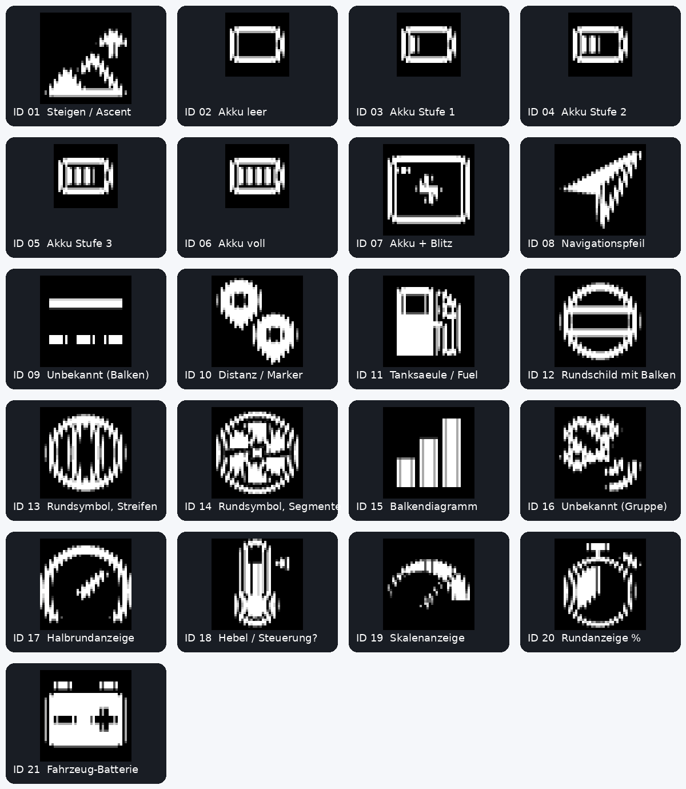

# ActiveLook image IDs observed on ENGO 2

Initial visual observations: 2026-10-19. Updated with pilot-reported direct
BLE inventory results from the same ENGO 2 on 2026-10-20.

Evidence levels in this document:

- **Device-reported facts:** inventory results supplied by the pilot from a
  Python diagnostic connected directly to the glasses over BLE on Windows.
  Raw packet logs and the diagnostic source were not supplied with this update;
  these results were not independently re-run by the documentation author.
- **Visual observations:** what the pilot saw through Ethos, not image names
  returned by the protocol.
- **Inference:** conclusions supported by these results but not directly traced.
- **Open questions:** details that have not yet been established.

## Direct BLE inventory (2026-10-20)

Device: ENGO 2, firmware **4.12.2b**. The diagnostic used official ActiveLook
commands: `vers` (0x06), `cfgList` (0xD3), `cfgRead` (0xD1), `cfgSet` (0xD2)
and `imgList` (0x47). Configuration selection was temporary. Inventory data
comes from the device, rather than the public visual asset table.

### Installed configurations ? device-reported facts

| Property | ALooK | frsky |
| --- | ---: | ---: |
| Version | 17 | 8 |
| Size (bytes) | 1,436,684 | 36,020 |
| Images reported by cfgRead | 109 | 21 |
| Entries returned by imgList | 105 | 21 |
| Layouts | 230 | 1 |
| Fonts | 8 | 5 |
| Pages | 3 | 0 |
| System configuration | Yes | No |

Both configurations were identified by `cfgList` and `cfgRead`. Thus a separate
FrSky-specific graphics library exists alongside the system library on this
unit. How FrSky/Ethos installs it and the exact activation mechanism remain
unknown. The reconnection test below confirms reactivation in the tested sequence.

### Hardware verification ? 2026-10-20

After explicitly selecting the `ALooK` configuration through the Windows BLE
diagnostic tool, the ENGO 2 was reconnected to ETHOS. Bitmap ID 2 immediately
displayed the empty-battery icon associated with the `frsky` configuration.
This confirms that the FrSky graphics configuration becomes active again during
the tested ETHOS reconnection sequence. The exact mechanism (explicit
`cfgSet("frsky")` or another initialization step) has not yet been verified.

This is a pilot-reported hardware verification on the tested ENGO 2 and ETHOS
setup, not a captured Bluetooth command trace or a guarantee for other versions.

### Complete frsky bitmap inventory

After explicit `cfgSet("frsky")`, `imgList` returned exactly these 21 entries.
Dimensions are width ? height, in pixels.

| Bitmap ID | Width | Height |
| --- | ---: | ---: |
| 1 | 40 | 40 |
| 2 | 28 | 28 |
| 3 | 28 | 28 |
| 4 | 28 | 28 |
| 5 | 28 | 28 |
| 6 | 28 | 28 |
| 7 | 40 | 40 |
| 8 | 40 | 40 |
| 9 | 40 | 40 |
| 10 | 40 | 40 |
| 11 | 40 | 40 |
| 12 | 40 | 40 |
| 13 | 40 | 40 |
| 14 | 40 | 40 |
| 15 | 40 | 40 |
| 16 | 40 | 40 |
| 17 | 40 | 40 |
| 18 | 40 | 40 |
| 19 | 40 | 40 |
| 20 | 40 | 40 |
| 21 | 40 | 40 |

ID 0 and all IDs from 22 upward are absent from this returned configuration
inventory. IDs 2-6 are 28x28; every other listed bitmap is 40x40. Motifs are
not provided by `imgList`: the visual identifications below remain separate.

### Additional ALooK version-17 images

The supplied inventory identifies these 26 additional IDs relative to the
older published asset catalogue; their motifs have not been identified.
This is not the complete 105-entry ALooK inventory.

| IDs | Width × height (pixels) |
| --- | --- |
| 81 | 28 × 28 |
| 82 | 40 × 40 |
| 83 | 29 × 28 |
| 84 | 40 × 40 |
| 85 | 29 × 28 |
| 86 | 40 × 40 |
| 87–88 | 244 × 122 |
| 89–95 | 46 × 46 |
| 100–110 | 28 × 28 |

**Unresolved discrepancy:** `cfgRead("ALooK")` reports 109 images, but `imgList`
returned 105 entries. The difference of four is unexplained; neither count
has been adjusted to match the other.

### Comparison with Ethos observations ? strongly supported inference

The earlier Ethos scan found no image at ID 0, battery states at 2?6, and no
visible images at 22?40. This closely matches the separately measured `frsky`
inventory. It strongly supports the hypothesis that the images seen through
Ethos came from `frsky` rather than the public ALooK library.

**Not yet proved:** that Ethos sends `cfgSet("frsky")` on connection, or which
routine chooses the configuration. Establishing that requires a trace or
inspection of the Ethos implementation. The inventory is not such a trace.

**ID 21 size correction:** the pilot originally judged its apparent size to
match IDs 2-6. Preserve that observation, but the device inventory establishes
40x40 for frsky ID 21 versus 28x28 for IDs 2-6. Apparent visual size and stored
bitmap dimensions need not coincide.

**Identification rule:** use configuration name **and** bitmap ID together.
For example, the public ALooK table calls ID 1 a 28x28 low-battery image;
frsky ID 1 is 40x40 and the pilot identified the Ethos image as ascent.
These are not interchangeable catalogues.

## Earlier pilot observations and source research

The following sections preserve the earlier observations and investigation.
Statements about unknown configuration inventories reflect what was known
before the direct BLE inventory above.

Reference: https://github.com/ActiveLook/Activelook-Visual-Assets

## Test context

- ENGO 2; glasses software v4.12.2b, graphical configuration 17, as reported
  by the pilot from the ActiveLook Android app.
- Ethos Lua `glasses.bitmap(x, y, id)` from the Rotorflight Low Fuel preview.
- Exact Ethos version and the configuration name selected by Ethos are unknown.
  The Android app reports graphical configuration version 17.
- One image at a time, IDs 0 through 10, with a visible ID label.

| Image ID | Pilot observation |
| --- | --- |
| 0 | No image visible |
| 1 | Ascent |
| 2 | Empty battery |
| 3-5 | Intermediate battery levels; individual levels not recorded |
| 6 | Full battery |
| 7 | Power-like symbol; identification uncertain |
| 8 | Navigation arrow |
| 9 | Not yet described |
| 10 | Distance symbol |
| 11 | Fuel pump / refuelling symbol |
| 12 | Not yet described |
| 21 | Car-battery-like symbol, not a charge-level indicator; originally judged the same apparent size as IDs 2-6; later frsky inventory: 40x40 versus 28x28 |
| 22-40 | No image visible in the isolated full-display diagnostic |

IDs 32, 33 and 42 also produced no visible image in an earlier test.
The later isolated diagnostic confirmed no visible output for IDs 22-40.
No visible output does not establish that an image ID is absent from storage.

## Implications for future work

Bitmap output works in this setup, but the observed IDs do not match the public
ALooK cfg-11 image table. The Android app reports graphical configuration 17,
so the reference table and the installed graphics have different version numbers.
This does not by itself prove how the IDs are mapped or which configuration
Ethos selects. Do not treat this mapping as universal for ENGO 2 or
other ActiveLook glasses. Firmware version alone does not identify the active
asset configuration. The pilot seeing startup animations confirms graphical
resources exist, but does not establish the configuration selected for Ethos.

ID 2 is a candidate for the Low Fuel empty-battery symbol in this tested setup.
IDs 2-6 are candidates for a five-state battery indicator, without uploading
images. Confirm intermediate levels and the actual configuration before using
them as a general default. The public asset repository remains useful as a
visual reference, rather than a verified ID mapping for this device.

## Ethos API reference example

Official Ethos ActiveLook example:
https://ethos-lua-doc.frsky-rc.com/examples/official/active-look/?h=acti

Use this as the reference for the documented Ethos glasses widget lifecycle,
layout creation, text/bitmap commands and standalone bitmap output. It does
not establish which image IDs exist in a particular glasses configuration.

## Public organization source search (2026-10-19)

Searched text files in the default-branch archives of all eight public ActiveLook
repositories: API documentation, iOS SDK, Android SDK, Visual Assets, demo-app,
Config-Generator, Garmin-Datafield-sample-code and Products. This was a search
of current source trees, not every historical revision, branch or issue.

The official Garmin example provides a direct configuration-17 reference:
https://github.com/ActiveLook/Garmin-Datafield-sample-code/blob/main/source/ActiveLookDataFieldView.mc#L442-L469

- `onFirmwareEvent` checks a minimum firmware version of 4.12.2 (within major 4).
- It selects `ALooK` with command 0xD2.
- `onCfgVersionEvent` requires configuration version 17 or newer.
- `source/ActiveLookSDK_next.mc` queries `ALooK` using cfgRead (0xD1).

This establishes that official application code uses ALooK version 17, but
provides no verified image-ID table for it. The public Visual Assets README
still describes version 11. No version-17 image library or battery-ID mapping
was identified in the searched text files. At that point, the pilot observations were the only confirmed visual mapping
for the tested Ethos setup; the later BLE inventory adds configuration-specific
IDs and dimensions, but does not identify additional motifs.

## Source interpretation and remaining questions

The public Visual Assets README describes **ALooK version 11**, while this
unit contains **ALooK version 17**. It is an older reference, not a complete
current catalogue and not a frsky catalogue. The measured frsky inventory and
extracted firmware resources below provide the configuration-specific evidence
for this implementation; ALooK IDs must not be substituted for frsky IDs.

Relevant upstream resources:

- [ActiveLook BLE protocol](https://github.com/ActiveLook/Activelook-API-Documentation/blob/main/ActiveLook_API.md)
- [Public ALooK visual assets](https://github.com/ActiveLook/Activelook-Visual-Assets)
- [Android SDK](https://github.com/ActiveLook/android-sdk)
- [iOS SDK](https://github.com/ActiveLook/ios-sdk)
- [Configuration generator](https://github.com/ActiveLook/Config-Generator)

The supplied task text ends mid-sentence in its SDK-updater section. No
specific updater behaviour is asserted here from that incomplete passage.
Configuration and firmware versions are recorded separately; do not infer
one from the other.

Still open:

- How Ethos installs frsky and reactivates it during reconnection: an explicit
  cfgSet command or another initialization step. Reactivation itself is confirmed
  for the tested sequence above.
- Why ALooK cfgRead and imgList counts differ by four.
- Motifs of additional ALooK version-17 images and official semantics of ambiguous frsky images.
- Exact numeric thresholds represented by frsky battery IDs 3?5; the extracted shapes show one, two and three fill bars.
- Applicability to other glasses, graphics versions and Ethos versions.

## 2026-10-20: X20PROAW-EU firmware.bin reverse engineering

### Provenance and verification boundaries

The pilot supplied `ENGO2_FRSKY_ID_Katalog.md` and
`ENGO2_FRSKY_21_Originalsymbole_und_Analyse.zip`. The accompanying analysis
reports read-only extraction from `firmware.bin` (8,660,408 bytes) inside
`X20PROAW-EU.zip`. No firmware was modified and no radio or glasses were
connected during that extraction, according to the supplied analysis.
The source firmware version and its SHA256 were not supplied, so this result
must not be generalized to every X20PROAW-EU build.

**Independently checked in the supplied package:** all 21 decoded 4bpp files
match their manifest SHA256 values and declared byte counts; all upright PNG
headers match the inventory dimensions. IDs and dimensions match all 21
entries returned by the separate BLE inventory for `frsky` version 8. This is
strong structural evidence that the extracted resource set corresponds to that
configuration, not a byte-for-byte readback comparison against glasses memory.
The source firmware was not supplied for this update, so extraction from that
firmware and the reported second-run reproducibility were not independently
re-run. Image names below are observations or visual descriptions, not names
recovered from the binary or confirmed official labels.

### Image overview: all 21 resources

The supplied overview labels are German; the descriptions in this reference
are English. Contrast enhancement is for inspection only, not source pixels.

| ID | Pixels | Description | Evidence / uncertainty |
| --- | --- | --- | --- |
| 1 | 40x40 | Ascent / climbing | Pilot observation; shape agrees with extracted image |
| 2 | 28x28 | Empty battery | Pilot observation; extracted image |
| 3 | 28x28 | Battery with one fill bar (roughly one quarter) | Visual description; no numeric threshold established |
| 4 | 28x28 | Battery with two fill bars (roughly one half) | Visual description; no numeric threshold established |
| 5 | 28x28 | Battery with three fill bars (roughly three quarters) | Visual description; no numeric threshold established |
| 6 | 28x28 | Full battery | Pilot observation; extracted image |
| 7 | 40x40 | Battery-like frame with lightning / plus-like mark | Visual description; earlier pilot identification was uncertain |
| 8 | 40x40 | Navigation arrow | Pilot observation; extracted image |
| 9 | 40x40 | Horizontal bar with a row of segments below | Visual description; official meaning unknown |
| 10 | 40x40 | Two location markers / distance | Pilot observation; extracted image |
| 11 | 40x40 | Fuel pump / refuelling | Pilot observation; extracted image |
| 12 | 40x40 | Circular outline with two horizontal bars | Visual description; official meaning unknown |
| 13 | 40x40 | Circular outline with vertical stripes | Visual description; official meaning unknown |
| 14 | 40x40 | Circular segmented shape | Visual description; official meaning unknown |
| 15 | 40x40 | Three rising bars | Visual description; official meaning unknown |
| 16 | 40x40 | Grouped shapes with a small adjoining mark | Visual description; official meaning unknown |
| 17 | 40x40 | Semicircular dial with pointer | Visual description; official meaning unknown |
| 18 | 40x40 | Vertical lever / control-like shape | Tentative visual description; official meaning unknown |
| 19 | 40x40 | Partial circular scale | Visual description; official meaning unknown |
| 20 | 40x40 | Round gauge / percentage-like display | Tentative visual description; official meaning unknown |
| 21 | 40x40 | Vehicle battery with plus and minus terminals | Pilot observation; extracted image |

Earlier pilot impressions remain recorded above. In particular, ID 21 appeared
the same size as the battery-state icons, but its stored dimensions are 40x40
versus 28x28 for IDs 2-6. ID 9 and ID 12 now have neutral shape descriptions;
their official meanings remain unknown. In this firmware resource set, the
40-pixel width used by the Low Fuel layout for image 11 is supported by the
extracted header and the separate BLE inventory.

### Reported extraction method

1. Locate 21 `imgSave` (0x41) initialization frames:
   `FF 41 00 0D <id> <u32 size> <u16 width> 02 AA`.
2. The supplied extractor expects headers in descending ID order 21 through 1.
   Each corresponding compressed data frame precedes its initialization frame.
3. Data frames use `FF 41 10 <u16 length> <compressed data> AA`. Some firmware
   blocks are cyclically rotated; the extractor aligns them using the header
   and length field before decoding.
4. Decode format 0x02: Heatshrink-compressed 4bpp, window 8, lookahead 4.
   Each decoded byte contains two 4-bit grayscale pixels.
5. Preserve the stored orientation and provide an upright preview rotated
   180 degrees. The overview above shows the upright symbols.
6. Record offsets, sizes and raw-data hashes in the manifest and CSV.

Package totals verified here: **14,760 decoded bytes** (800 per 40x40 image;
392 per 28x28 image) and **4,073 compressed bytes** summed from manifest
metadata. The supplied analysis reports that all 21 streams decoded to their
expected lengths and a second extraction produced identical raw bytes.

The supplied script requires Pillow and the original firmware file. It was
reviewed as text but not executed for this update. Its regenerated manifest
uses `fmt` and `raw_sha256`, whereas the supplied manifest uses `format` and
`sha256`; compare the underlying IDs, dimensions and raw hashes rather than
expecting byte-identical metadata files.

The firmware extraction does not establish how Ethos installs or selects `frsky`.
The separate hardware reconnection test above confirms reactivation during that
tested sequence, but not its mechanism. Neither result maps ALooK version 17
or guarantees that future frsky versions use the same IDs.
